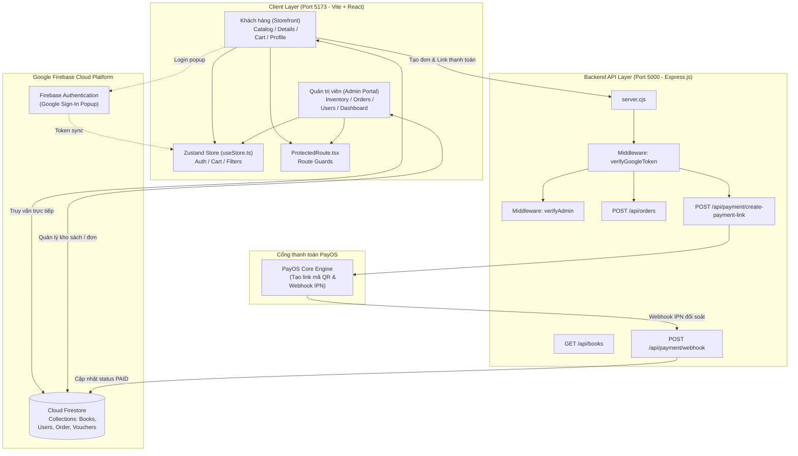

# 📚 HỆ THỐNG QUẢN LÝ VÀ VẬN HÀNH THƯ VIỆN - NHÀ SÁCH TRỰC TUYẾN
> **BookVerse Library & E-Commerce Management System**  
> Nền tảng thương mại điện tử và quản lý thư viện sách hiện đại, tích hợp xác thực Firebase, cơ sở dữ liệu Cloud Firestore thời gian thực và cổng thanh toán tự động PayOS (VietQR).

---

## 🛠️ 1. CÔNG NGHỆ SỬ DỤNG (TECH STACK)

### 🎨 Frontend (Giao diện người dùng & Quản trị)
- **Framework & Runtime:** [React 18](https://react.dev/) + [TypeScript](https://www.typescriptlang.org/)
- **Bundler & Build Tool:** [Vite 6](https://vitejs.dev/) (Tối ưu hóa build nhanh, HMR tức thì)
- **Styling & UI Design:** [TailwindCSS v3](https://tailwindcss.com/) (Hệ màu tokens Semantic Surface & Container, Material Theme) + [Lucide React](https://lucide.dev/) & [Material Symbols](https://fonts.google.com/icons)
- **State Management:** [Zustand](https://github.com/pmndrs/zustand) (Quản lý trạng thái tập trung: Giỏ hàng, Đăng nhập, Bộ lọc, Thông báo Toast)
- **Routing & Navigation:** [React Router DOM v6](https://reactrouter.com/) (Hỗ trợ Nested Routes và Route Guards bảo vệ các phân vùng nhạy cảm)
- **Client SDKs:** Firebase Client SDK v11 (Authentication với Google Sign-in popup, Cloud Firestore queries)

### ⚙️ Backend (Máy chủ API & Xử lý giao dịch)
- **Môi trường máy chủ:** [Node.js](https://nodejs.org/) (Cú pháp CommonJS / `server.cjs`)
- **Web Framework:** [Express.js](https://expressjs.com/) (RESTful APIs, Middlewares kiểm duyệt)
- **Xác thực Admin & Quản trị:** [Firebase Admin SDK v12+](https://firebase.google.com/docs/admin/setup) (Xác thực Google ID Token, phân quyền Admin role)
- **Cổng thanh toán:** [@payos/node](https://payos.vn/) (Tạo liên kết thanh toán mã QR chuẩn VietQR tự động và tiếp nhận Webhook đối soát giao dịch)
- **Tiện ích:** `cors` (Cấu hình Cross-Origin Resource Sharing), `dotenv` (Bảo mật biến môi trường)

### ☁️ Cơ sở dữ liệu & Đám mây (Cloud Infrastructure)
- **Database:** [Google Cloud Firestore](https://firebase.google.com/docs/firestore) (NoSQL thời gian thực, các collections: `Books`, `Users`, `Order`, `Vouchers`)
- **Authentication:** [Firebase Authentication](https://firebase.google.com/docs/auth) (Google OAuth 2.0 Identity Provider)
- **Payment Gateway:** [PayOS VietQR](https://payos.vn/)

---

## 🏗️ 2. SƠ ĐỒ KIẾN TRÚC HỆ THỐNG



---

## 📁 3. CẤU TRÚC THƯ MỤC & GIẢI THÍCH CÁC FILE QUAN TRỌNG

```text
├── server.cjs                 # [BACKEND] Máy chủ Express kết nối Firebase Admin & PayOS
├── vite.config.ts             # [CONFIG] Cấu hình build Vite & cơ chế chặn đọc file nhạy cảm
├── tailwind.config.js         # [CONFIG] Thiết kế bảng màu semantic, typography và spacing
├── package.json               # [CONFIG] Danh mục thư viện và các kịch bản chạy lệnh
├── .gitignore                 # [SECURITY] Chặn đẩy file nhạy cảm, secrets, test scratch
├── index.html                 # [CLIENT] Trang HTML chính của ứng dụng
│
├── tests/                     # [TESTING] Bộ kịch bản kiểm thử tự động toàn diện
│   ├── phase5_verification_suite.mjs # Master Test Suite kiểm tra 54 tiêu chí bảo mật & E2E
│   └── fixtures/              # Dữ liệu phục vụ kiểm thử biệt lập
│
└── src/                       # [FRONTEND SOURCE]
    ├── main.tsx               # Điểm khởi đầu của ứng dụng React (Mount DOM)
    ├── App.tsx                # Khai báo tuyến đường (Routes), lắng nghe auth, layout
    ├── index.css              # Tùy biến CSS toàn cục và Tailwind directives
    │
    ├── services/              # Tầng kết nối dịch vụ ngoài
    │   ├── firebase.ts        # [RẤT QUAN TRỌNG] Khởi tạo Firebase Client, ánh xạ schema Firestore
    │   └── payos.ts           # [RẤT QUAN TRỌNG] Giao tiếp gọi API tạo link thanh toán PayOS
    │
    ├── store/                 # Quản lý trạng thái toàn cục
    │   └── useStore.ts        # [RẤT QUAN TRỌNG] Zustand store: Auth, Cart, Toast, Danh mục
    │
    ├── types/                 # Định nghĩa kiểu TypeScript
    │   └── index.ts           # Định nghĩa Type: Book, User, Order, Voucher, CartItem
    │
    ├── layouts/               # Khung sườn giao diện
    │   ├── StorefrontLayout.tsx # Khung giao diện độc giả (Header + Body + Footer + Cart)
    │   └── AdminLayout.tsx      # Khung giao diện quản trị (Admin Sidebar + Header)
    │
    ├── pages/                 # Các trang màn hình chính
    │   ├── Home.tsx           # Trang chủ giới thiệu sách, banner và các bộ sưu tập tuyển chọn
    │   ├── Catalog.tsx        # Trang khám phá sách: Tìm kiếm, lọc thể loại/giá, phân trang
    │   ├── BookDetails.tsx    # Chi tiết sách, đánh giá, thông tin tác giả & thêm vào giỏ
    │   ├── CartCheckout.tsx   # Giỏ hàng, nhập địa chỉ, áp mã giảm giá & nút thanh toán PayOS
    │   ├── PaymentSuccess.tsx # Màn hình xác nhận thanh toán thành công (xóa giỏ, cập nhật đơn)
    │   ├── PaymentCancel.tsx  # Màn hình thông báo hủy giao dịch thanh toán
    │   ├── UserProfile.tsx    # Trang cá nhân của độc giả: Lịch sử đơn hàng, địa chỉ, thống kê
    │   ├── Auth.tsx           # Trang Đăng nhập / Đăng ký & Nút Đăng nhập Google Popup
    │   ├── AdminDashboard.tsx # Bảng điều khiển quản trị: KPI doanh thu, cảnh báo hết hàng
    │   ├── AdminInventory.tsx # Quản lý kho sách: Thêm, sửa, xóa sách, bìa, thể loại, giá
    │   ├── AdminOrders.tsx    # Quản lý vòng đời đơn hàng (Chờ xử lý, Đang giao, Đã giao)
    │   ├── AdminUsers.tsx     # Quản lý danh sách độc giả và phân quyền Admin/Customer
    │   └── AdminVouchers.tsx  # Quản lý mã ưu đãi, voucher giảm giá
    │
    └── components/            # Các khối giao diện tái sử dụng
        ├── common/            # Thành phần dùng chung toàn hệ thống
        │   ├── StorefrontHeader.tsx # Header chính: Logo, thanh tìm kiếm, giỏ hàng, Avatar user
        │   ├── ProfileDropdown.tsx  # Menu tài khoản: Xem trang cá nhân, đổi vai trò, Đăng xuất
        │   ├── ProtectedRoute.tsx   # [RẤT QUAN TRỌNG] Bảo vệ route: Chặn chưa đăng nhập, phân quyền Admin
        │   └── FloatingCartDrawer.tsx # Giỏ hàng trượt nhanh bên phải màn hình
        ├── auth/              # Thành phần xác thực
        │   ├── SocialOAuthDivider.tsx # Giao diện nút đăng nhập mạng xã hội (Google)
        │   ├── SignInForm.tsx         # Form đăng nhập tài khoản email
        │   └── RegisterForm.tsx       # Form đăng ký tài khoản độc giả mới
        ├── admin-inventory/   # Giao diện quản lý kho sách
        │   ├── AddBookModal.tsx       # Modal thêm ấn phẩm mới (URL ảnh, nhiều thể loại, 3 mức giá)
        │   ├── EditBookModal.tsx      # Modal chỉnh sửa thông tin sách
        │   └── InventoryTable.tsx     # Bảng danh mục sách trong kho
        ├── admin-dashboard/   # Các widget thống kê số liệu
        │   ├── KpiMetricsBento.tsx    # Thẻ thống kê Bento grid (Doanh thu, Đơn hàng, Ấn phẩm)
        │   └── LowStockAlertsCard.tsx # Cảnh báo sách sắp hết hàng trong kho
        └── cart-checkout/     # Khối tính toán thanh toán
            └── OrderSummaryCard.tsx   # Tóm tắt đơn hàng, nút kích hoạt thanh toán PayOS
```

---

## 🔑 4. CHI TIẾT TÁC DỤNG CỦA CÁC TỆP TIN QUAN TRỌNG NHẤT

| Tên tập tin | Vị trí | Tác dụng và Trách nhiệm chính |
| :--- | :--- | :--- |
| **`server.cjs`** | Gốc dự án | Máy chủ Express chính chạy ở cổng `5000`. Cấu hình Firebase Admin SDK kết nối cơ sở dữ liệu `Firestore`. Chứa các middleware bảo mật (`verifyGoogleToken`, `verifyAdmin`), API tạo đơn hàng (`POST /api/orders`), API tích hợp PayOS tạo mã QR (`POST /api/payment/create-payment-link`), và Webhook tiếp nhận thanh toán tự động (`POST /api/payment/webhook`). |
| **`src/services/firebase.ts`** | `src/services/` | Cấu hình Firebase Client SDK cho trình duyệt. Cung cấp đối tượng xác thực `auth`, cơ sở dữ liệu `db`, `googleProvider`. Khai báo các hàm thao tác Firestore (`fetchBooks`, `fetchOrders`, `syncUserProfileToFirestore`) kèm cơ chế chuyển đổi dữ liệu (schema mappers) an toàn kiểu dữ liệu. |
| **`src/services/payos.ts`** | `src/services/` | Đóng gói giao tiếp mạng từ Frontend tới Backend PayOS. Tự động lấy Bearer Token từ phiên đăng nhập Firebase của người dùng để gọi API `/api/payment/create-payment-link`, nhận lại đường dẫn thanh toán `checkoutUrl`. |
| **`src/store/useStore.ts`** | `src/store/` | Quản lý state toàn cục bằng Zustand: Lưu trữ thông tin người dùng đang đăng nhập (`user`, `idToken`), giỏ hàng (`cartItems`), mở/đóng giỏ hàng trượt, hiển thị thông báo popup Toast và lưu các bộ lọc tìm kiếm sách. |
| **`src/components/common/ProtectedRoute.tsx`** | `src/components/` | Cổng bảo vệ tuyến đường (Route Guard). Kiểm tra xem người dùng đã đăng nhập hay chưa (nếu chưa, chuyển hướng về trang `/login`). Đồng thời kiểm tra xem người dùng có quyền `ADMIN` hay không khi cố gắng truy cập các trang quản trị `/admin/*`. |
| **`src/pages/Auth.tsx`** | `src/pages/` | Xử lý toàn bộ logic đăng nhập/đăng ký. Khởi chạy Firebase `signInWithPopup`, kiểm tra sự tồn tại của người dùng trong Firestore collection `"users"` để tạo tài khoản mới nếu đăng nhập lần đầu, và điều hướng thông minh theo quyền hạn. |
| **`src/pages/CartCheckout.tsx`** | `src/pages/` | Quản lý quy trình chốt đơn: Nhập địa chỉ giao hàng, phương thức vận chuyển, kiểm tra đăng nhập, lưu đơn hàng vào Firestore và chuyển hướng khách hàng sang trang thanh toán mã QR của PayOS. |
| **`vite.config.ts`** | Gốc dự án | Cấu hình máy chủ Vite chạy ở cổng `5173`. Tích hợp quy tắc bảo mật `server.fs.deny` nhằm chặn triệt để dev-server đọc hoặc để lộ các file chứa khóa bí mật (`serviceAccountKey*.json`, `.env*`, `*.cjs`). |

---

## 🚀 5. HƯỚNG DẪN CÀI ĐẶT VÀ KHỞI CHẠY HỆ THỐNG

### Bước 1: Cài đặt các gói phụ thuộc (Dependencies)
```bash
npm install
```

### Bước 2: Cấu hình biến môi trường
Tạo file `.env` (hoặc `.env.local`) tại thư mục gốc với các cấu hình:
```env
# Backend Ports & Secrets
PORT=5000
PAYOS_CLIENT_ID=your_client_id
PAYOS_API_KEY=your_api_key
PAYOS_CHECKSUM_KEY=your_checksum_key

# Frontend Firebase Configuration
VITE_FIREBASE_API_KEY=your_api_key
VITE_FIREBASE_AUTH_DOMAIN=your_project.firebaseapp.com
VITE_FIREBASE_PROJECT_ID=your_project_id
VITE_FIREBASE_STORAGE_BUCKET=your_project.appspot.com
VITE_FIREBASE_MESSAGING_SENDER_ID=your_sender_id
VITE_FIREBASE_APP_ID=your_app_id
```
*(Đồng thời đặt file chứng chỉ quản trị `serviceAccountKey.json` của Firebase Admin SDK tại thư mục gốc - file này đã được chặn commit bởi `.gitignore`).*

### Bước 3: Khởi chạy máy chủ Backend (Port 5000)
```bash
node server.cjs
```

### Bước 4: Khởi chạy giao diện Frontend (Port 5173)
```bash
npm run dev
```
Truy cập hệ thống tại: `http://localhost:5173`

### Bước 5: Chạy bộ kiểm thử tự động toàn diện
```bash
npm run test:phase5
```
*(Kiểm tra toàn bộ 54 tiêu chí về xóa mock data, kết nối Firestore thực, đăng nhập Google, luồng thanh toán PayOS và bảo mật secret keys).*

---
© 2026 BookVerse Library & E-Commerce Management System. All rights reserved.
---

## 🛠️ 1. CÔNG NGHỆ SỬ DỤNG (TECH STACK)

### 🎨 Frontend (Giao diện người dùng & Quản trị)
- **Framework & Runtime:** [React 18](https://react.dev/) + [TypeScript](https://www.typescriptlang.org/)
- **Bundler & Build Tool:** [Vite 6](https://vitejs.dev/) (Tối ưu hóa build nhanh, HMR tức thì)
- **Styling & UI Design:** [TailwindCSS v3](https://tailwindcss.com/) (Hệ màu tokens Semantic Surface & Container, Material Theme) + [Lucide React](https://lucide.dev/) & [Material Symbols](https://fonts.google.com/icons)
- **State Management:** [Zustand](https://github.com/pmndrs/zustand) (Quản lý trạng thái tập trung: Giỏ hàng, Đăng nhập, Bộ lọc, Thông báo Toast)
- **Routing & Navigation:** [React Router DOM v6](https://reactrouter.com/) (Hỗ trợ Nested Routes và Route Guards bảo vệ các phân vùng nhạy cảm)
- **Client SDKs:** Firebase Client SDK v11 (Authentication với Google Sign-in popup, Cloud Firestore queries)

### ⚙️ Backend (Máy chủ API & Xử lý giao dịch)
- **Môi trường máy chủ:** [Node.js](https://nodejs.org/) (Cú pháp CommonJS / `server.cjs`)
- **Web Framework:** [Express.js](https://expressjs.com/) (RESTful APIs, Middlewares kiểm duyệt)
- **Xác thực Admin & Quản trị:** [Firebase Admin SDK v12+](https://firebase.google.com/docs/admin/setup) (Xác thực Google ID Token, phân quyền Admin role)
- **Cổng thanh toán:** [@payos/node](https://payos.vn/) (Tạo liên kết thanh toán mã QR chuẩn VietQR tự động và tiếp nhận Webhook đối soát giao dịch)
- **Tiện ích:** `cors` (Cấu hình Cross-Origin Resource Sharing), `dotenv` (Bảo mật biến môi trường)

### ☁️ Cơ sở dữ liệu & Đám mây (Cloud Infrastructure)
- **Database:** [Google Cloud Firestore](https://firebase.google.com/docs/firestore) (NoSQL thời gian thực, các collections: `Books`, `Users`, `Order`, `Vouchers`)
- **Authentication:** [Firebase Authentication](https://firebase.google.com/docs/auth) (Google OAuth 2.0 Identity Provider)
- **Payment Gateway:** [PayOS VietQR](https://payos.vn/)

---

## 🏗️ 2. SƠ ĐỒ KIẾN TRÚC HỆ THỐNG


---

## 📁 3. CẤU TRÚC THƯ MỤC & GIẢI THÍCH CÁC FILE QUAN TRỌNG

```text
├── server.cjs                 # [BACKEND] Máy chủ Express kết nối Firebase Admin & PayOS
├── vite.config.ts             # [CONFIG] Cấu hình build Vite & cơ chế chặn đọc file nhạy cảm
├── tailwind.config.js         # [CONFIG] Thiết kế bảng màu semantic, typography và spacing
├── package.json               # [CONFIG] Danh mục thư viện và các kịch bản chạy lệnh
├── .gitignore                 # [SECURITY] Chặn đẩy file nhạy cảm, secrets, test scratch
├── index.html                 # [CLIENT] Trang HTML chính của ứng dụng
│
├── tests/                     # [TESTING] Bộ kịch bản kiểm thử tự động toàn diện
│   ├── phase5_verification_suite.mjs # Master Test Suite kiểm tra 54 tiêu chí bảo mật & E2E
│   └── fixtures/              # Dữ liệu phục vụ kiểm thử biệt lập
│
└── src/                       # [FRONTEND SOURCE]
    ├── main.tsx               # Điểm khởi đầu của ứng dụng React (Mount DOM)
    ├── App.tsx                # Khai báo tuyến đường (Routes), lắng nghe auth, layout
    ├── index.css              # Tùy biến CSS toàn cục và Tailwind directives
    │
    ├── services/              # Tầng kết nối dịch vụ ngoài
    │   ├── firebase.ts        # [RẤT QUAN TRỌNG] Khởi tạo Firebase Client, ánh xạ schema Firestore
    │   └── payos.ts           # [RẤT QUAN TRỌNG] Giao tiếp gọi API tạo link thanh toán PayOS
    │
    ├── store/                 # Quản lý trạng thái toàn cục
    │   └── useStore.ts        # [RẤT QUAN TRỌNG] Zustand store: Auth, Cart, Toast, Danh mục
    │
    ├── types/                 # Định nghĩa kiểu TypeScript
    │   └── index.ts           # Định nghĩa Type: Book, User, Order, Voucher, CartItem
    │
    ├── layouts/               # Khung sườn giao diện
    │   ├── StorefrontLayout.tsx # Khung giao diện độc giả (Header + Body + Footer + Cart)
    │   └── AdminLayout.tsx      # Khung giao diện quản trị (Admin Sidebar + Header)
    │
    ├── pages/                 # Các trang màn hình chính
    │   ├── Home.tsx           # Trang chủ giới thiệu sách, banner và các bộ sưu tập tuyển chọn
    │   ├── Catalog.tsx        # Trang khám phá sách: Tìm kiếm, lọc thể loại/giá, phân trang
    │   ├── BookDetails.tsx    # Chi tiết sách, đánh giá, thông tin tác giả & thêm vào giỏ
    │   ├── CartCheckout.tsx   # Giỏ hàng, nhập địa chỉ, áp mã giảm giá & nút thanh toán PayOS
    │   ├── PaymentSuccess.tsx # Màn hình xác nhận thanh toán thành công (xóa giỏ, cập nhật đơn)
    │   ├── PaymentCancel.tsx  # Màn hình thông báo hủy giao dịch thanh toán
    │   ├── UserProfile.tsx    # Trang cá nhân của độc giả: Lịch sử đơn hàng, địa chỉ, thống kê
    │   ├── Auth.tsx           # Trang Đăng nhập / Đăng ký & Nút Đăng nhập Google Popup
    │   ├── AdminDashboard.tsx # Bảng điều khiển quản trị: KPI doanh thu, cảnh báo hết hàng
    │   ├── AdminInventory.tsx # Quản lý kho sách: Thêm, sửa, xóa sách, bìa, thể loại, giá
    │   ├── AdminOrders.tsx    # Quản lý vòng đời đơn hàng (Chờ xử lý, Đang giao, Đã giao)
    │   ├── AdminUsers.tsx     # Quản lý danh sách độc giả và phân quyền Admin/Customer
    │   └── AdminVouchers.tsx  # Quản lý mã ưu đãi, voucher giảm giá
    │
    └── components/            # Các khối giao diện tái sử dụng
        ├── common/            # Thành phần dùng chung toàn hệ thống
        │   ├── StorefrontHeader.tsx # Header chính: Logo, thanh tìm kiếm, giỏ hàng, Avatar user
        │   ├── ProfileDropdown.tsx  # Menu tài khoản: Xem trang cá nhân, đổi vai trò, Đăng xuất
        │   ├── ProtectedRoute.tsx   # [RẤT QUAN TRỌNG] Bảo vệ route: Chặn chưa đăng nhập, phân quyền Admin
        │   └── FloatingCartDrawer.tsx # Giỏ hàng trượt nhanh bên phải màn hình
        ├── auth/              # Thành phần xác thực
        │   ├── SocialOAuthDivider.tsx # Giao diện nút đăng nhập mạng xã hội (Google)
        │   ├── SignInForm.tsx         # Form đăng nhập tài khoản email
        │   └── RegisterForm.tsx       # Form đăng ký tài khoản độc giả mới
        ├── admin-inventory/   # Giao diện quản lý kho sách
        │   ├── AddBookModal.tsx       # Modal thêm ấn phẩm mới (URL ảnh, nhiều thể loại, 3 mức giá)
        │   ├── EditBookModal.tsx      # Modal chỉnh sửa thông tin sách
        │   └── InventoryTable.tsx     # Bảng danh mục sách trong kho
        ├── admin-dashboard/   # Các widget thống kê số liệu
        │   ├── KpiMetricsBento.tsx    # Thẻ thống kê Bento grid (Doanh thu, Đơn hàng, Ấn phẩm)
        │   └── LowStockAlertsCard.tsx # Cảnh báo sách sắp hết hàng trong kho
        └── cart-checkout/     # Khối tính toán thanh toán
            └── OrderSummaryCard.tsx   # Tóm tắt đơn hàng, nút kích hoạt thanh toán PayOS
```

---

## 🔑 4. CHI TIẾT TÁC DỤNG CỦA CÁC TỆP TIN QUAN TRỌNG NHẤT

| Tên tập tin | Vị trí | Tác dụng và Trách nhiệm chính |
| :--- | :--- | :--- |
| **`server.cjs`** | Gốc dự án | Máy chủ Express chính chạy ở cổng `5000`. Cấu hình Firebase Admin SDK kết nối cơ sở dữ liệu `Firestore`. Chứa các middleware bảo mật (`verifyGoogleToken`, `verifyAdmin`), API tạo đơn hàng (`POST /api/orders`), API tích hợp PayOS tạo mã QR (`POST /api/payment/create-payment-link`), và Webhook tiếp nhận thanh toán tự động (`POST /api/payment/webhook`). |
| **`src/services/firebase.ts`** | `src/services/` | Cấu hình Firebase Client SDK cho trình duyệt. Cung cấp đối tượng xác thực `auth`, cơ sở dữ liệu `db`, `googleProvider`. Khai báo các hàm thao tác Firestore (`fetchBooks`, `fetchOrders`, `syncUserProfileToFirestore`) kèm cơ chế chuyển đổi dữ liệu (schema mappers) an toàn kiểu dữ liệu. |
| **`src/services/payos.ts`** | `src/services/` | Đóng gói giao tiếp mạng từ Frontend tới Backend PayOS. Tự động lấy Bearer Token từ phiên đăng nhập Firebase của người dùng để gọi API `/api/payment/create-payment-link`, nhận lại đường dẫn thanh toán `checkoutUrl`. |
| **`src/store/useStore.ts`** | `src/store/` | Quản lý state toàn cục bằng Zustand: Lưu trữ thông tin người dùng đang đăng nhập (`user`, `idToken`), giỏ hàng (`cartItems`), mở/đóng giỏ hàng trượt, hiển thị thông báo popup Toast và lưu các bộ lọc tìm kiếm sách. |
| **`src/components/common/ProtectedRoute.tsx`** | `src/components/` | Cổng bảo vệ tuyến đường (Route Guard). Kiểm tra xem người dùng đã đăng nhập hay chưa (nếu chưa, chuyển hướng về trang `/login`). Đồng thời kiểm tra xem người dùng có quyền `ADMIN` hay không khi cố gắng truy cập các trang quản trị `/admin/*`. |
| **`src/pages/Auth.tsx`** | `src/pages/` | Xử lý toàn bộ logic đăng nhập/đăng ký. Khởi chạy Firebase `signInWithPopup`, kiểm tra sự tồn tại của người dùng trong Firestore collection `"users"` để tạo tài khoản mới nếu đăng nhập lần đầu, và điều hướng thông minh theo quyền hạn. |
| **`src/pages/CartCheckout.tsx`** | `src/pages/` | Quản lý quy trình chốt đơn: Nhập địa chỉ giao hàng, phương thức vận chuyển, kiểm tra đăng nhập, lưu đơn hàng vào Firestore và chuyển hướng khách hàng sang trang thanh toán mã QR của PayOS. |
| **`vite.config.ts`** | Gốc dự án | Cấu hình máy chủ Vite chạy ở cổng `5173`. Tích hợp quy tắc bảo mật `server.fs.deny` nhằm chặn triệt để dev-server đọc hoặc để lộ các file chứa khóa bí mật (`serviceAccountKey*.json`, `.env*`, `*.cjs`). |

---

## 🚀 5. HƯỚNG DẪN CÀI ĐẶT VÀ KHỞI CHẠY HỆ THỐNG

### Bước 1: Cài đặt các gói phụ thuộc (Dependencies)
```bash
npm install
```

### Bước 2: Cấu hình biến môi trường
Tạo file `.env` (hoặc `.env.local`) tại thư mục gốc với các cấu hình:
```env
# Backend Ports & Secrets
PORT=5000
PAYOS_CLIENT_ID=your_client_id
PAYOS_API_KEY=your_api_key
PAYOS_CHECKSUM_KEY=your_checksum_key

# Frontend Firebase Configuration
VITE_FIREBASE_API_KEY=your_api_key
VITE_FIREBASE_AUTH_DOMAIN=your_project.firebaseapp.com
VITE_FIREBASE_PROJECT_ID=your_project_id
VITE_FIREBASE_STORAGE_BUCKET=your_project.appspot.com
VITE_FIREBASE_MESSAGING_SENDER_ID=your_sender_id
VITE_FIREBASE_APP_ID=your_app_id
```
*(Đồng thời đặt file chứng chỉ quản trị `serviceAccountKey.json` của Firebase Admin SDK tại thư mục gốc - file này đã được chặn commit bởi `.gitignore`).*

### Bước 3: Khởi chạy máy chủ Backend (Port 5000)
```bash
node server.cjs
```

### Bước 4: Khởi chạy giao diện Frontend (Port 5173)
```bash
npm run dev
```
Truy cập hệ thống tại: `http://localhost:5173`

### Bước 5: Chạy bộ kiểm thử tự động toàn diện
```bash
npm run test:phase5
```
*(Kiểm tra toàn bộ 54 tiêu chí về xóa mock data, kết nối Firestore thực, đăng nhập Google, luồng thanh toán PayOS và bảo mật secret keys).*

---
© 2026 BookVerse Library & E-Commerce Management System. All rights reserved.
