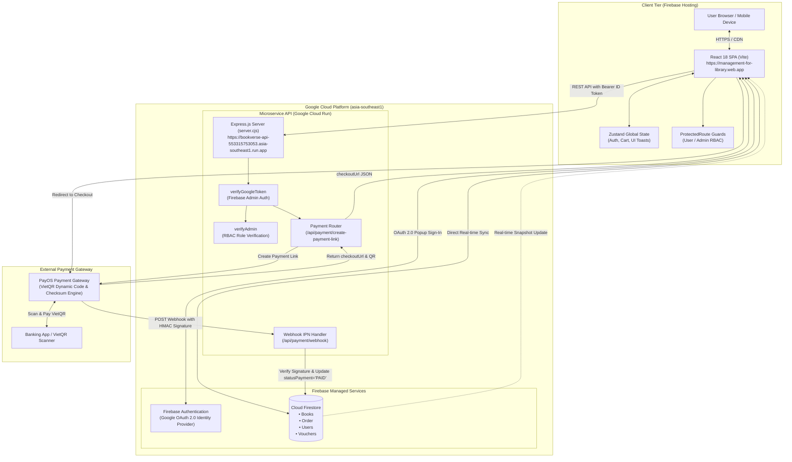
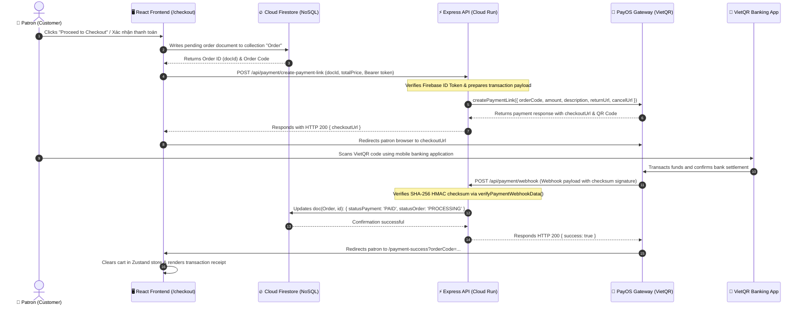

# 📖 BookVerse — Online Bookstore & Library Management System
### *Hệ Thống Quản Lý Thư Viện & Nhà Sách Trực Tuyến Hiện Đại*

<div align="center">

[](https://react.dev/)
[](https://www.typescriptlang.org/)
[](https://vitejs.dev/)
[](https://nodejs.org/)
[](https://expressjs.com/)
[](https://firebase.google.com/)
[](https://cloud.google.com/run)
[](https://payos.vn/)
[](https://www.docker.com/)
[](https://tailwindcss.com/)

<p align="center">
  <strong>🌐 Live Deployments & Quick Access:</strong><br />
  <a href="https://management-for-library.web.app">
    
  </a>
  &nbsp;&nbsp;
  <a href="https://bookverse-api-553315753053.asia-southeast1.run.app">
    
  </a>
  &nbsp;&nbsp;
  <a href="https://github.com/KT265/Library-management-and-operation-system">
    
  </a>
</p>

</div>

---

## 📌 Executive Summary / Tổng Quan Dự Án

### 🇬🇧 English
**BookVerse** is a production-grade, full-stack hybrid web platform combining a modern **Online Bookstore** with an automated **Library Management & Circulation System**. Built with React 18, TypeScript, and Vite on the client layer, and powered by an Express.js microservice deployed on Google Cloud Run alongside Google Cloud Firestore real-time NoSQL, BookVerse provides seamless book borrowing, automated VietQR checkout reconciliation via PayOS webhooks, granular Role-Based Access Control (RBAC), and an administrative analytics dashboard.

### 🇻🇳 Tiếng Việt
**BookVerse** là nền tảng thương mại điện tử kết hợp quản lý và vận hành thư viện sách trực tuyến toàn diện, đạt tiêu chuẩn phát triển ứng dụng hiện đại. Hệ thống sử dụng React 18, TypeScript và Vite cho giao diện người dùng, kết hợp máy chủ microservice Express.js trên Google Cloud Run cùng cơ sở dữ liệu thời gian thực Cloud Firestore. BookVerse hỗ trợ quản lý mượn/trả sách, thanh toán tự động qua mã VietQR (PayOS) với cơ chế Webhook tức thì, phân quyền người dùng đa cấp (RBAC) và bảng điều khiển phân tích số liệu vận hành chuyên nghiệp.

---

## 📑 Table of Contents / Mục Lục
1. [Header & Badges / Thông Tin Dự Án](#1-header--badges--thông-tin-dự-án)
2. [Key Features / Tính Năng Nổi Bật](#2-key-features--tính-năng-nổi-bật)
3. [Tech Stack / Công Nghệ Sử Dụng](#3-tech-stack--công-nghệ-sử-dụng)
4. [Project Structure / Cấu Trúc Dự Án](#4-project-structure--cấu-trúc-dự-án)
5. [Architecture & Payment Flow / Kiến Trúc Hệ Thống & Luồng Thanh Toán](#5-architecture--payment-flow--kiến-trúc-hệ-thống--luồng-thanh-toán)
6. [Getting Started / Hướng Dẫn Cài Đặt & Khởi Chạy](#6-getting-started--hướng-dẫn-cài-đặt--khởi-chạy)

---

<a id="1-header--badges--thông-tin-dự-án" name="1-header--badges--thông-tin-dự-án"></a>
<a id="-1-header--badges--thông-tin-dự-án" name="-1-header--badges--thông-tin-dự-án"></a>
## 🏷️ 1. Header & Badges / Thông Tin Dự Án

| Attribute / Thông Tin | Production Detail / Chi Tiết Thực Tế |
| :--- | :--- |
| **Project Name / Tên Dự Án** | **BookVerse — Online Bookstore & Library Management System** |
| **Frontend Deployment** | **Firebase Hosting**: [https://management-for-library.web.app](https://management-for-library.web.app) |
| **Backend API Endpoint** | **Google Cloud Run**: [https://bookverse-api-553315753053.asia-southeast1.run.app](https://bookverse-api-553315753053.asia-southeast1.run.app) |
| **Cloud Project ID** | `management-for-library` (Region: `asia-southeast1`) |
| **Payment Gateway** | PayOS VietQR Open Payment Gateway (Automated IPN Webhook) |
| **Repository** | [GitHub Repository](https://github.com/KT265/Library-management-and-operation-system) |

---

<a id="2-key-features--tính-năng-nổi-bật" name="2-key-features--tính-năng-nổi-bật"></a>
<a id="-2-key-features--tính-năng-nổi-bật" name="-2-key-features--tính-năng-nổi-bật"></a>
## ✨ 2. Key Features / Tính Năng Nổi Bật

### 📚 2.1 Book Catalog & Discovery / Khám Phá & Quản Lý Danh Mục Sách
* **Real-time Firestore Catalog (`/catalog`):** Live database search by book title, author, and ISBN with zero hardcoded mock delays.
  * *🇻🇳 Tìm kiếm trực tiếp theo tên sách, tác giả và ISBN trên cơ sở dữ liệu Cloud Firestore theo thời gian thực.*
* **Multi-facet Filtering & Categorization:** Interactive category chips (Literature, Science, Technology, Business, Arts, History) combined with price range sliders and stock status filters.
  * *🇻🇳 Bộ lọc đa chiều trực quan theo thể loại (Văn học, Khoa học, Công nghệ, Kinh doanh, Nghệ thuật, Lịch sử), thanh trượt khoảng giá và bộ lọc trạng thái tồn kho.*
* **Dynamic Sorting & Pagination:** Responsive sorting by price (ascending/descending), patron ratings, publication year, and client-side pagination with empty-state indicators.
  * *🇻🇳 Sắp xếp linh hoạt theo giá bán (tăng/giảm dần), đánh giá của bạn đọc, năm xuất bản và phân trang mượt mà kèm giao diện hiển thị khi không có kết quả.*
* **Detailed Book Page (`/book/:id`):** Cover gallery, book specifications (ISBN, publisher, page count, language), verified reader reviews, and related genre recommendation carousels.
  * *🇻🇳 Trang chi tiết sách với bộ sưu tập ảnh bìa, thông số kỹ thuật (ISBN, nhà xuất bản, số trang, ngôn ngữ), đánh giá từ độc giả đã xác thực và gợi ý sách cùng thể loại.*

### 🛒 2.2 Cart & Automated PayOS Checkout / Giỏ Hàng & Thanh Toán VietQR Tự Động
* **Interactive Shopping Cart:** Slide-over floating cart drawer with real-time subtotal calculation, 8% VAT tax calculation, and bulk item selection.
  * *🇻🇳 Ngăn kéo giỏ hàng trượt mượt mà với tính năng tự động tính toán tổng tiền tạm tính theo thời gian thực, thuế VAT 8% và chọn/bỏ chọn sản phẩm hàng loạt.*
* **Promotional Discount Engine:** Dynamic coupon and voucher validation with minimum spend thresholds and maximum discount caps.
  * *🇻🇳 Động cơ áp dụng mã giảm giá và voucher linh hoạt với điều kiện chi tiêu tối thiểu và giới hạn số tiền giảm tối đa.*
* **Dual Payment Gateways (`/checkout`):**
  * **VietQR / PayOS:** Instant QR code generation with encrypted checksum signature. *(Tạo mã QR thanh toán tức thì qua ngân hàng với chữ ký bảo mật checksum).*
  * **Cash on Delivery (COD):** Direct checkout with shipping address validation. *(Thanh toán tiền mặt khi nhận hàng với xác thực thông tin và địa chỉ giao hàng).*
* **Real-time Webhook Reconciliation (`POST /api/payment/webhook`):** Cloud Run API verifies PayOS HMAC SHA256 signatures and automatically updates order status to `PAID` in Firestore upon successful bank transfer.
  * *🇻🇳 Máy chủ Cloud Run API đối soát chữ ký số bảo mật HMAC SHA256 từ PayOS và tự động cập nhật trạng thái đơn hàng sang `PAID` trên Firestore ngay khi chuyển khoản thành công.*
* **Dedicated Status Redirects:**
  * `/payment-success`: Displays verified transaction invoice, triggers automatic cart clearing, and links to order tracking. *(Hiển thị hóa đơn thanh toán xác thực, tự động dọn sạch giỏ hàng và liên kết theo dõi đơn hàng).*
  * `/payment-cancel`: Preserves active shopping cart state and offers one-click retry actions. *(Giữ nguyên trạng thái giỏ hàng và cung cấp nút thử lại thanh toán tiện lợi).*

### 🔄 2.3 Borrow & Return Library Operations / Vận Hành Mượn - Trả Sách Thư Viện
* **Circulation Lifecycle Tracking:** Complete state-machine tracking: `PENDING` ➔ `PAID` ➔ `PROCESSING` ➔ `DELIVERING` ➔ `DELIVERED` / `RETURNED` / `CANCELLED`.
  * *🇻🇳 Quản lý toàn bộ vòng đời lưu thông mượn/trả sách theo mô hình máy trạng thái: Chờ xử lý ➔ Đã thanh toán ➔ Đang xử lý ➔ Đang giao ➔ Đã giao / Đã trả sách / Đã hủy.*
* **Circulation Console (`/admin/orders`):** Dedicated administrative console for managing physical book loans, tracking return deadlines, and recording overdue/returned statuses.
  * *🇻🇳 Bảng điều khiển quản trị chuyên dụng cho nghiệp vụ mượn sách vật lý, theo dõi thời hạn trả sách và ghi nhận trạng thái quá hạn/hoàn trả.*
* **Patron Reading Metrics Sync:** Delivering a completed order or book loan automatically increments the patron's lifetime reading count in Cloud Firestore.
  * *🇻🇳 Xác nhận giao sách hoặc hoàn tất lượt mượn sẽ tự động tăng số lượng sách đã đọc tích lũy của bạn đọc trên Cloud Firestore.*

### 🔐 2.4 User Roles & Authentication (RBAC) / Phân Quyền & Xác Thực Người Dùng
* **Multi-provider Authentication (`/login`, `/register`):** Google OAuth 2.0 popup sign-in (`signInWithPopup`) and secure Email/Password authentication.
  * *🇻🇳 Đăng nhập đa phương thức: Đăng nhập tài khoản Google (OAuth 2.0) tiện lợi qua popup và đăng nhập/đăng ký tài khoản bằng Email & Mật khẩu.*
* **Role-Based Access Control (RBAC):** Strict partition between regular patrons (`USER` / `customer`) and administrators (`ADMIN`).
  * *🇻🇳 Phân quyền truy cập đa cấp nghiêm ngặt giữa bạn đọc thông thường (`USER` / `customer`) và quản trị viên hệ thống (`ADMIN`).*
* **Route Protection (`ProtectedRoute.tsx`):** Unauthenticated patrons accessing `/checkout`, `/profile`, or `/orders` are redirected to login with return-path preservation. All `/admin/*` routes strictly require administrative privileges.
  * *🇻🇳 Bảo vệ định tuyến thông minh: Điều hướng bạn đọc chưa xác thực khi truy cập `/checkout`, `/profile` về trang đăng nhập và tự động quay lại sau khi đăng nhập thành công. Toàn bộ tuyến `/admin/*` bắt buộc quyền Admin.*
* **Patron Dashboard (`/profile`):** Bento-grid reading stats (books read, active loans, reviews written), order history timeline, and personal profile management.
  * *🇻🇳 Bảng điều khiển cá nhân giao diện Bento: Thống kê số sách đã đọc, lượt mượn đang diễn ra, đánh giá đã viết, dòng thời gian lịch sử đơn hàng và quản lý hồ sơ cá nhân.*

### 📊 2.5 Analytics Dashboard & Operations / Bảng Điều Khiển Quản Trị & Phân Tích
* **Executive Bento Overview (`/admin/dashboard`):** Real-time aggregation of Total Revenue, Total Orders, Active Inventory, and Total Registered Patrons.
  * *🇻🇳 Bảng tổng quan quản trị Bento-grid: Tổng hợp theo thời gian thực về Tổng doanh thu, Tổng đơn hàng, Tổng đầu sách trong kho và Số lượng bạn đọc đăng ký.*
* **Low-Stock Alert System:** Instant warning triggers for books with inventory below reorder thresholds.
  * *🇻🇳 Hệ thống cảnh báo tồn kho thấp tự động kích hoạt khi số lượng bản sách xuống dưới ngưỡng an toàn.*
* **Book Inventory CRUD (`/admin/inventory`):** Full inventory management with Add Book modal, Edit Book modal, stock adjustment, and deletion confirmation guards.
  * *🇻🇳 Quản lý kho sách toàn diện với các hộp thoại Thêm sách mới, Chỉnh sửa thông tin, Điều chỉnh số lượng và Xác nhận xóa sách an toàn.*
* **User Permissions Directory (`/admin/users`):** Searchable patron roster with on-the-fly role promotion/demotion (`USER` ⇄ `ADMIN`).
  * *🇻🇳 Danh bạ bạn đọc có thể tìm kiếm với tính năng phân quyền và chuyển đổi vai trò trực tiếp (`USER` ⇄ `ADMIN`).*
* **Voucher Campaign Manager (`/admin/vouchers`):** Promotional campaign creation with customizable code generators, discount rates, spend limits, and expiration controls.
  * *🇻🇳 Trình quản lý chiến dịch voucher với bộ sinh mã khuyến mãi tự động, cấu hình tỷ lệ giảm giá, hạn mức đơn hàng và thời hạn sử dụng.*

---

<a id="3-tech-stack--công-nghệ-sử-dụng" name="3-tech-stack--công-nghệ-sử-dụng"></a>
<a id="-3-tech-stack--công-nghệ-sử-dụng" name="-3-tech-stack--công-nghệ-sử-dụng"></a>
## 💻 3. Tech Stack / Công Nghệ Sử Dụng

### 🇬🇧 English Breakdown

| Category | Technology | Version | Purpose & Architectural Role |
| :--- | :--- | :--- | :--- |
| **Frontend Framework** | React | `^18.3.1` | Declarative component UI hierarchy with React 18 hooks |
| **Language** | TypeScript | `^5.6.3` | End-to-end static typing for domain models, mappers, and APIs |
| **Bundler & Dev Server**| Vite | `^6.0.1` | Lightning-fast HMR on port 5173 with strict `fs.deny` credential protection |
| **Styling & Design** | TailwindCSS | `^3.4.19` | Utility-first responsive design, semantic design tokens, and dark theme support |
| **Icons & UI Symbols** | Material UI Icons | `^5.16.12` | Accessible iconography for administrative tables and storefront navigation |
| **State Management** | Zustand | `^5.0.2` | Minimalist global store for cart state, auth sessions, and toast alerts |
| **Client Routing** | React Router DOM | `^6.28.0` | Client-side routing, nested layouts, and protected route wrappers |
| **Backend Runtime** | Node.js | `>=20.x` | High-performance asynchronous JavaScript server runtime |
| **API Framework** | Express.js | `^5.3.0` | REST API routing, CORS configuration, and webhook handling |
| **Database** | Cloud Firestore | `^9.4.1` / `^13.2.0` | Real-time NoSQL cloud database (`Books`, `Order`, `Users`, `Vouchers`) |
| **Authentication** | Firebase Auth | `^13.2.0` | Google Identity Provider & Firebase Client SDK v13 modular imports |
| **Server Admin SDK** | Firebase Admin | `^14.5.0` | Privileged server-side Firestore operations and ID token verification |
| **Payment Gateway** | PayOS Node SDK | `^2.0.5` | VietQR link creation and cryptographic webhook signature verification |
| **Containerization** | Docker | `Alpine 20` | Lightweight Linux image for cloud deployment (port 8080) |
| **Cloud Deployment** | Cloud Run & Firebase | Serverless | Serverless backend on Google Cloud Run and static CDN on Firebase Hosting |

### 🇻🇳 Phân Loại Công Nghệ

* **Giao diện (Frontend):** React 18, TypeScript 5, Vite 6, TailwindCSS 3, Zustand 5, React Router DOM 6, Emotion & Material Icons.
* **Máy chủ (Backend):** Node.js 20+, Express.js 5, Firebase Admin SDK 14, PayOS Node SDK 2, CORS, Dotenv.
* **Cơ sở dữ liệu & Xác thực:** Google Cloud Firestore (NoSQL thời gian thực), Firebase Authentication (Google OAuth 2.0).
* **Đám mây & Vận hành (Cloud & DevOps):** Google Cloud Run (Container microservice), Firebase Hosting (Global CDN), Docker (Alpine container).

---

<a id="4-project-structure--cấu-trúc-dự-án" name="4-project-structure--cấu-trúc-dự-án"></a>
<a id="-4-project-structure--cấu-trúc-dự-án" name="-4-project-structure--cấu-trúc-dự-án"></a>
## 📂 4. Project Structure / Cấu Trúc Dự Án

```text
.
├── Dockerfile                   # Docker container specification for Cloud Run deployment (Node 20 Alpine)
├── firebase.json                # Firebase Hosting configuration with SPA rewrite rules to /index.html
├── .firebaserc                  # Firebase project binding (management-for-library)
├── index.html                   # HTML entry point for the Vite Single Page Application
├── package.json                 # Project dependencies, scripts, and package metadata
├── payosConfig.cjs              # PayOS client configuration helper
├── postcss.config.js            # PostCSS configuration for TailwindCSS processing
├── PROJECT.md                   # System specifications and verification contracts
├── README.md                    # Bilingual project documentation (English & Tiếng Việt)
├── scripts/
│   ├── run-e2e-tests.mjs        # End-to-end test runner executing 30 test suites
│   └── sanitize-dist.cjs        # Post-build distribution sanitization script
├── seed.cjs                     # Database seeding script for Firestore collections
├── server.cjs                   # Express backend server (Firebase Admin, PayOS API & Webhook, port 5000/8080)
├── tailwind.config.js           # TailwindCSS custom theme, color tokens, and font extensions
├── tests/                       # Comprehensive test suites (E2E, boundary, stress, security)
│   ├── e2e/                     # End-to-end test suites covering storefront, admin, auth, and payments
│   └── fixtures/                # Isolated test mock data and schema fixtures
├── tsconfig.json                # TypeScript compiler configuration
├── vite.config.ts               # Vite configuration (port 5173, fs.deny security, React plugin)
└── src/
    ├── App.tsx                  # Root application component, route declarations, and auth provider
    ├── main.tsx                 # React DOM entry point mounting root App
    ├── index.css                # Global CSS styles and Tailwind directives
    ├── vite-env.d.ts            # Vite client environment type declarations
    ├── components/              # Modular UI components organized by domain
    │   ├── admin-dashboard/     # Admin analytics KPI cards, low-stock alerts, recent orders table
    │   ├── admin-inventory/     # Book inventory management, Add/Edit book modals, delete dialog
    │   ├── admin-orders/        # Order fulfillment table, circulation console modal, status filters
    │   ├── admin-users/         # User directory, role editing modal (ADMIN / USER), permission header
    │   ├── admin-vouchers/      # Promotion management, voucher creation modal, status table
    │   ├── auth/                # Sign-in and registration forms, Google OAuth divider button
    │   ├── book-details/        # Book specifications, cover gallery, reviews, and related carousel
    │   ├── cart-checkout/       # Cart item list, shipping selector, address form, PayOS QR panel
    │   ├── catalog/             # Search bar, genre category chips, book grid, filter drawer
    │   ├── common/              # Reusable components: StorefrontHeader, Footer, ToastNotification, ProtectedRoute
    │   ├── home/                # Hero banner, curated genres section, featured picks, patron reviews
    │   └── user-profile/        # Reading statistics bento, order timeline tracking, review modal
    ├── hooks/                   # Custom React hooks (useBookRating, useVoucherStatusCheck)
    ├── layouts/                 # Page layout shells (StorefrontLayout, AdminLayout)
    ├── pages/                   # Application route views
    │   ├── AdminDashboard.tsx   # Operations analytics overview
    │   ├── AdminInventory.tsx   # Library catalog management
    │   ├── AdminOrders.tsx      # Circulation & fulfillment dashboard
    │   ├── AdminUsers.tsx       # User & role permissions management
    │   ├── AdminVouchers.tsx    # Discount voucher & campaign management
    │   ├── Auth.tsx             # Authentication portal (Login & Register)
    │   ├── BookDetails.tsx      # Detailed book view and borrowing/purchase actions
    │   ├── CartCheckout.tsx     # Shopping cart and multi-method checkout workflow
    │   ├── Catalog.tsx          # Book catalog browsing with multi-facet filters
    │   ├── Home.tsx             # Storefront landing page
    │   ├── PaymentCancel.tsx    # Cancelled payment fallback page
    │   ├── PaymentSuccess.tsx   # Order confirmation & payment success page
    │   └── UserProfile.tsx      # Patron profile, reading stats, and loan history
    ├── services/                # External service integrations & data mappers
    │   ├── firebase.ts          # Firebase Client SDK setup, Firestore mappers, and auth handlers
    │   └── payos.ts             # PayOS API client for checkout link generation & auth token resolution
    ├── store/                   # Global state management
    │   └── useStore.ts          # Zustand store for auth session, cart items, search filters, and toasts
    ├── theme/                   # Custom theme tokens and stylistic definitions
    ├── types/                   # TypeScript interfaces and schema type declarations
    └── utils/                   # Helper functions (currency formatting, date calculations)
```

### 📂 Directory Overview / Giải Thích Thư Mục Chính

| Directory / Thư Mục | Role & Architectural Purpose (English) | Vai Trò & Chức Năng Kiến Trúc (Tiếng Việt) |
| :--- | :--- | :--- |
| `src/components/` | Domain-driven modular UI components (admin, storefront, auth, cart, catalog) | Các thành phần giao diện theo module nghiệp vụ (quản trị, cửa hàng, xác thực, giỏ hàng, danh mục) |
| `src/pages/` | Application route views and top-level pages mapped to React Router | Các trang giao diện chính gắn liền với định tuyến React Router |
| `src/services/` | External API clients and Firebase modular service bindings | Tầng kết nối dịch vụ ngoài: Firebase Client SDK và PayOS API client |
| `src/hooks/` | Custom React hooks for ratings, voucher status, and lifecycle events | Các custom hook React xử lý logic tái sử dụng (đánh giá, kiểm tra voucher) |
| `src/store/` | Zustand centralized store managing auth session, cart items, search filters, and toasts | Kho lưu trữ trạng thái toàn cục Zustand (phiên đăng nhập, giỏ hàng, bộ lọc, thông báo toast) |
| `src/layouts/` | Structural layout shells (`StorefrontLayout`, `AdminLayout`) | Các layout khung sườn dùng chung cho giao diện khách hàng và quản trị |
| `src/types/` | Domain TypeScript interfaces, database schemas, and contracts | Khai báo kiểu dữ liệu tĩnh TypeScript cho toàn bộ mô hình dữ liệu |
| `src/utils/` | Shared utility helpers (currency formatting, date calculations) | Hàm tiện ích tái sử dụng (định dạng tiền tệ VND, xử lý thời gian) |
| `scripts/` | Tooling automation scripts (E2E test orchestrator, dist sanitizer) | Tập lệnh tự động hóa (chạy kiểm thử E2E, dọn dẹp thư mục dist build) |
| `tests/` | 30 E2E and integration test suites covering all screens and boundaries | Hệ thống 30 bộ kiểm thử tích hợp và E2E bao phủ toàn diện 11 màn hình |

---

<a id="5-architecture--payment-flow--kiến-trúc-hệ-thống--luồng-thanh-toán" name="5-architecture--payment-flow--kiến-trúc-hệ-thống--luồng-thanh-toán"></a>
<a id="-5-architecture--payment-flow--kiến-trúc-hệ-thống--luồng-thanh-toán" name="-5-architecture--payment-flow--kiến-trúc-hệ-thống--luồng-thanh-toán"></a>
## 🏗️ 5. Architecture & Payment Flow / Kiến Trúc Hệ Thống & Luồng Thanh Toán

### 🌐 5.1 High-Level Cloud Architecture / Sơ Đồ Kiến Trúc Hệ Thống



---

### 💳 5.2 End-to-End PayOS Payment & Webhook Flow / Quy Trình Thanh Toán PayOS Chi Tiết



### 🇬🇧 English Explanation
1. **Checkout Initiation:** The patron reviews their cart and clicks "Proceed to Checkout". A pending order document is created in the Firestore `"Order"` collection with `statusPayment: 'PENDING'`.
2. **Payment Link Generation:** The frontend dispatches an authenticated HTTP request (`POST /api/payment/create-payment-link` or alias `/api/payment/create-link`) accompanied by the Firebase ID token in the `Authorization: Bearer <token>` header.
3. **PayOS Transaction Registration:** The Express API validates the patron's credentials, calculates order integrity, and calls `@payos/node` to issue a dynamic VietQR transaction link with signed return and cancel callbacks.
4. **Patron Redirect & Settlement:** The patron is redirected to the secure PayOS payment portal and completes the transaction using any banking app supporting standard VietQR.
5. **Real-time Webhook Processing:** Upon transaction settlement, PayOS delivers an Instant Payment Notification (IPN) to `POST /api/payment/webhook`. The server cryptographically validates the data using `PAYOS_CHECKSUM_KEY`.
6. **Order Reconciliation & Completion:** The backend reconciles the order state directly in Cloud Firestore (`statusPayment: 'PAID'`). The customer is redirected to `/payment-success`, where the Zustand shopping cart is automatically cleared.

### 🇻🇳 Giải Thích Tiếng Việt
1. **Khởi tạo đơn hàng:** Khách hàng kiểm tra giỏ hàng và chọn "Thanh toán". Một bản ghi đơn hàng mới được tạo trên Firestore collection `"Order"` với trạng thái `statusPayment: 'PENDING'`.
2. **Yêu cầu tạo liên kết thanh toán:** Frontend gửi yêu cầu được bảo vệ bằng Firebase ID Token (`POST /api/payment/create-payment-link`) tới máy chủ Express trên Cloud Run.
3. **Khởi tạo mã VietQR:** Máy chủ kiểm tra phiên đăng nhập và gọi SDK `@payos/node` để tạo liên kết thanh toán VietQR chứa chữ ký bảo mật kèm đường dẫn phản hồi `returnUrl` và `cancelUrl`.
4. **Quét mã chuyển khoản:** Người dùng được chuyển hướng sang trang thanh toán PayOS và dùng ứng dụng ngân hàng bất kỳ để quét mã VietQR tự động điền số tiền và nội dung.
5. **Tiếp nhận Webhook IPN:** Khi tiền vào tài khoản thành công, PayOS gửi Webhook tức thì tới endpoint `POST /api/payment/webhook`. Máy chủ thực hiện kiểm tra mã băm SHA-256 đối soát giao dịch an toàn.
6. **Cập nhật trạng thái:** Máy chủ chuyển trạng thái đơn hàng trên Firestore sang `statusPayment: 'PAID'`. Khách hàng được chuyển về trang `/payment-success`, giỏ hàng được tự động dọn sạch.

---

<a id="6-getting-started--hướng-dẫn-cài-đặt--khởi-chạy" name="6-getting-started--hướng-dẫn-cài-đặt--khởi-chạy"></a>
<a id="-6-getting-started--hướng-dẫn-cài-đặt--khởi-chạy" name="-6-getting-started--hướng-dẫn-cài-đặt--khởi-chạy"></a>
## 🚀 6. Getting Started / Hướng Dẫn Cài Đặt & Khởi Chạy

### 📋 Prerequisites / Yêu Cầu Môi Trường
* **Node.js**: v20.x or higher (`v20+` LTS recommended, e.g. Node v20/v26) / *Khuyến nghị bản LTS v20+*
* **npm**: v9.x or higher / *Phiên bản v9 trở lên*
* **Git**: Installed and configured / *Đã cài đặt Git*
* **Docker** *(Optional for local container testing)*: Docker Desktop / Engine / *Tùy chọn khi thử nghiệm container*

---

### 📥 1. Clone Repository / Sao Chép Mã Nguồn

```bash
git clone https://github.com/KT265/Library-management-and-operation-system.git
cd "Library-management-and-operation-system"
```

---

### 📦 2. Install Dependencies / Cài Đặt Thư Viện

```bash
npm install
```

---

### ⚙️ 3. Environment Configuration / Cấu Hình Biến Môi Trường

Create two separate environment configuration files in the root directory: `.env` for backend credentials and `.env.local` for the Vite frontend client.  
*Tạo hai tệp cấu hình môi trường độc lập tại thư mục gốc: `.env` cho máy chủ backend và `.env.local` cho máy khách frontend Vite.*

> [!CAUTION]
> **Security Notice / Lưu Ý Bảo Mật:** Never commit real secrets or credentials to source control. The examples below use sanitized placeholder templates.  
> *Tuyệt đối không đẩy thông tin nhạy cảm lên Git. Các ví dụ dưới đây đều sử dụng giá trị mẫu an toàn.*

#### A. Backend Environment File (`.env`)
Create a file named `.env` in the root folder / *Tạo tệp `.env` tại thư mục gốc:*

```env
# ==============================================================================
# SERVER CONFIGURATION
# ==============================================================================
PORT=5000

# ==============================================================================
# PAYOS PAYMENT GATEWAY CREDENTIALS (Backend Only - Keep Secret)
# ==============================================================================
PAYOS_CLIENT_ID=your_payos_client_id_placeholder
PAYOS_API_KEY=your_payos_api_key_placeholder
PAYOS_CHECKSUM_KEY=your_payos_checksum_key_placeholder

# ==============================================================================
# FIREBASE ADMIN SDK (Service Account Credential)
# ==============================================================================
FIREBASE_SERVICE_ACCOUNT_PATH=./serviceAccountKey.json
```
*(Ensure `serviceAccountKey.json` downloaded from the Firebase Console is placed in the project root; this file is ignored by `.gitignore`).*  
*(Đảm bảo tệp `serviceAccountKey.json` tải từ Firebase Console được đặt tại thư mục gốc; tệp này đã được cấu hình ẩn trong `.gitignore`).*

#### B. Frontend Environment File (`.env.local`)
Create a file named `.env.local` in the root folder / *Tạo tệp `.env.local` tại thư mục gốc:*

```env
# ==============================================================================
# FIREBASE CLIENT CONFIGURATION (Public Vite Variables)
# ==============================================================================
VITE_FIREBASE_API_KEY=your_firebase_api_key_placeholder
VITE_FIREBASE_AUTH_DOMAIN=management-for-library.firebaseapp.com
VITE_FIREBASE_PROJECT_ID=management-for-library
VITE_FIREBASE_STORAGE_BUCKET=management-for-library.firebasestorage.app
VITE_FIREBASE_MESSAGING_SENDER_ID=your_messaging_sender_id_placeholder
VITE_FIREBASE_APP_ID=your_firebase_app_id_placeholder

# ==============================================================================
# BACKEND API URL (Optional in development, defaults to http://localhost:5000)
# ==============================================================================
VITE_BACKEND_URL=http://localhost:5000
```

---

### 💻 4. Local Development Commands / Lệnh Khởi Chạy Môi Trường Cục Bộ

Run the backend API and frontend client in separate terminal windows:  
*Chạy máy chủ API và máy khách giao diện trong hai cửa sổ terminal riêng biệt:*

#### Terminal 1 — Start Express Backend API Server (Port 5000) / *Khởi chạy Backend Express:*
```bash
npm run server
```
*API will listen at `http://localhost:5000` with status health-check available at `http://localhost:5000/`.*  
*Máy chủ lắng nghe tại `http://localhost:5000`, kiểm tra trạng thái tại `http://localhost:5000/`.*

#### Terminal 2 — Start Vite React Frontend Dev Server (Port 5173) / *Khởi chạy Frontend React:*
```bash
npm run dev
```
*Vite local dev server will start at `http://localhost:5173`.*  
*Giao diện người dùng Vite khởi chạy tại `http://localhost:5173`.*

#### 🗄️ Optional: Seed Initial Firestore Database / *Nạp dữ liệu mẫu ban đầu (Tùy chọn):*
If you have configured `serviceAccountKey.json` and wish to populate initial sample library books, authors, and vouchers into Cloud Firestore:  
*Nếu bạn đã cấu hình `serviceAccountKey.json` và muốn nạp danh mục sách mẫu, tác giả và voucher ban đầu vào Cloud Firestore:*
```bash
node seed.cjs
```

---

### 🧪 5. Testing & Verification Suites / Chạy Kiểm Thử Hệ Thống

BookVerse includes an extensive automated verification and E2E test framework:  
*BookVerse tích hợp hệ thống kiểm thử tự động toàn diện từ E2E đến tĩnh:*

```bash
# Run all 30 End-to-End & Integration Test Suites across all 11 screens
# Chạy toàn bộ 30 bộ kiểm thử tích hợp & E2E trên 11 màn hình
npm test

# Run TypeScript static compiler typecheck
# Kiểm tra kiểu dữ liệu tĩnh TypeScript không lỗi
npx tsc --noEmit
```

---

### 🚢 6. Production Build & Deployment Commands / Lệnh Đóng Gói & Triển Khai

#### A. Build Frontend Single Page Application (SPA) / *Đóng gói Frontend:*
```bash
# Typecheck and build optimized distribution into dist/
# Biên dịch và tối ưu hóa ứng dụng vào thư mục dist/
npm run build

# Preview production build locally
# Xem trước bản đóng gói production tại môi trường cục bộ
npm run preview
```

#### B. Deploy Frontend to Firebase Hosting / *Triển khai lên Firebase Hosting:*
```bash
firebase deploy --only hosting
```

#### C. Build & Deploy Backend Container to Google Cloud Run / *Triển khai Backend lên Google Cloud Run:*
```bash
# 1. Build Docker image with Google Cloud SDK
docker build -t gcr.io/management-for-library/bookverse-api:latest .

# 2. Push image to Google Container Registry / Artifact Registry
docker push gcr.io/management-for-library/bookverse-api:latest

# 3. Deploy container service to Google Cloud Run
gcloud run deploy bookverse-api \
  --image gcr.io/management-for-library/bookverse-api:latest \
  --platform managed \
  --region asia-southeast1 \
  --allow-unauthenticated \
  --set-env-vars PORT=8080
```

---

## 📄 License & Attribution / Bản Quyền & Tác Giả

Distributed under the **MIT License**. Developed with ❤️ by **KT265** and the BookVerse Core Team.  
*Phát hành theo giấy phép **MIT License**. Phát triển bởi **KT265** và Đội ngũ BookVerse.*

* **GitHub Repository:** [https://github.com/KT265/Library-management-and-operation-system](https://github.com/KT265/Library-management-and-operation-system)
* **Frontend Web App:** [https://management-for-library.web.app](https://management-for-library.web.app)
* **Backend API Gateway:** [https://bookverse-api-553315753053.asia-southeast1.run.app](https://bookverse-api-553315753053.asia-southeast1.run.app)
